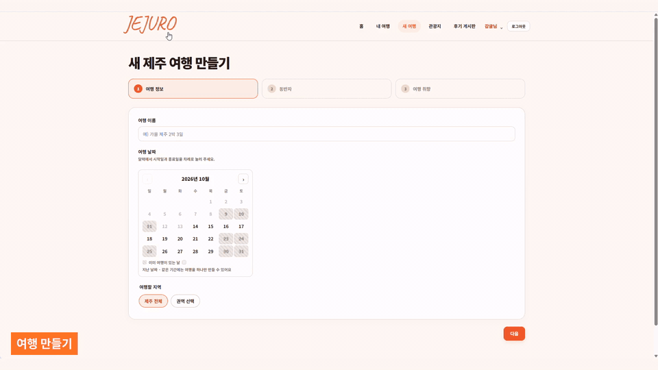
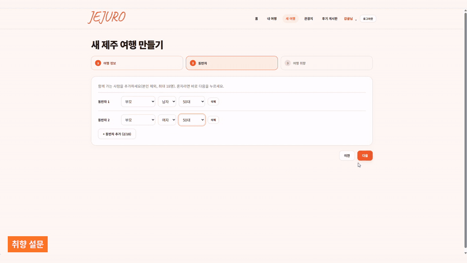
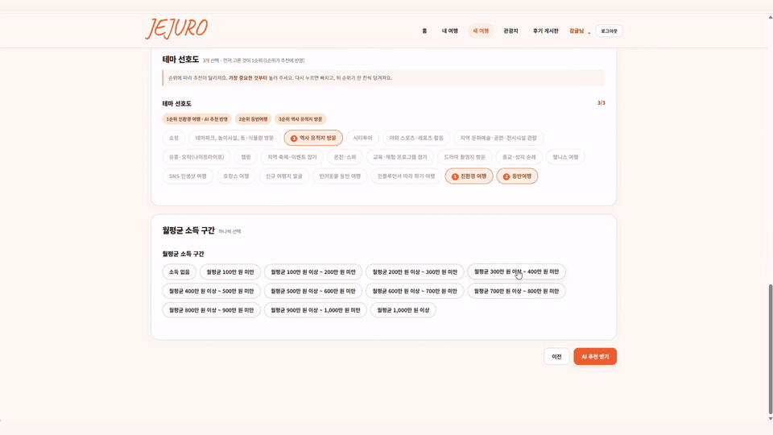
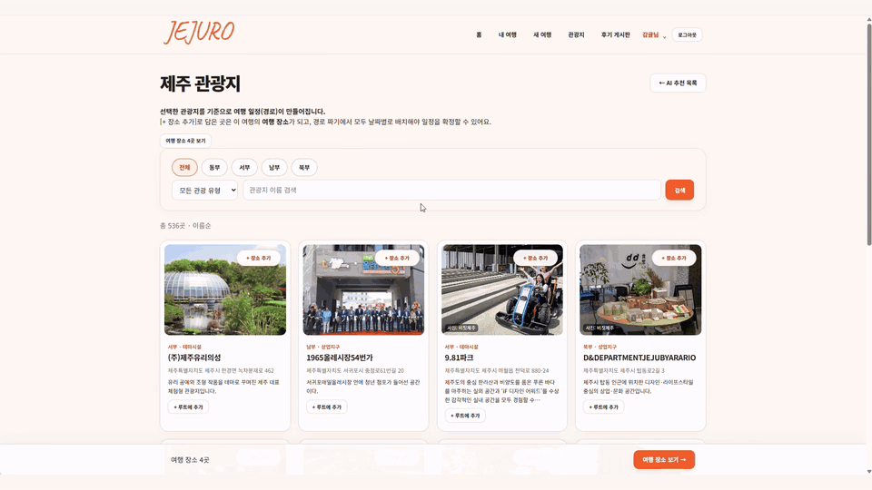
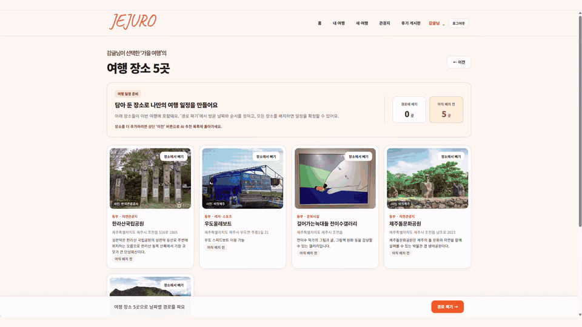
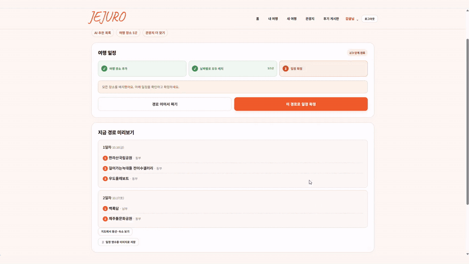
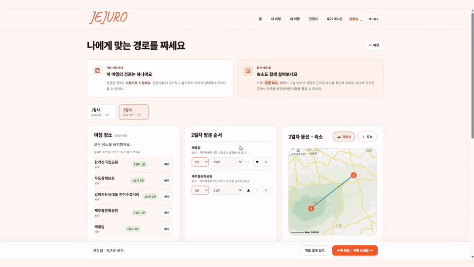
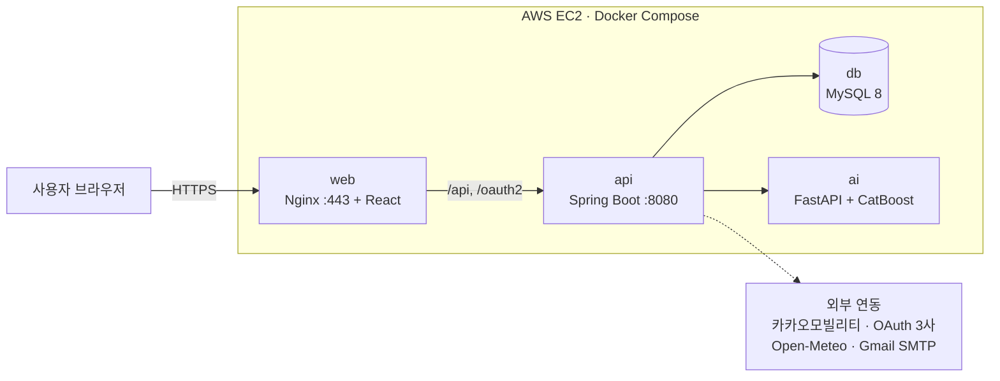
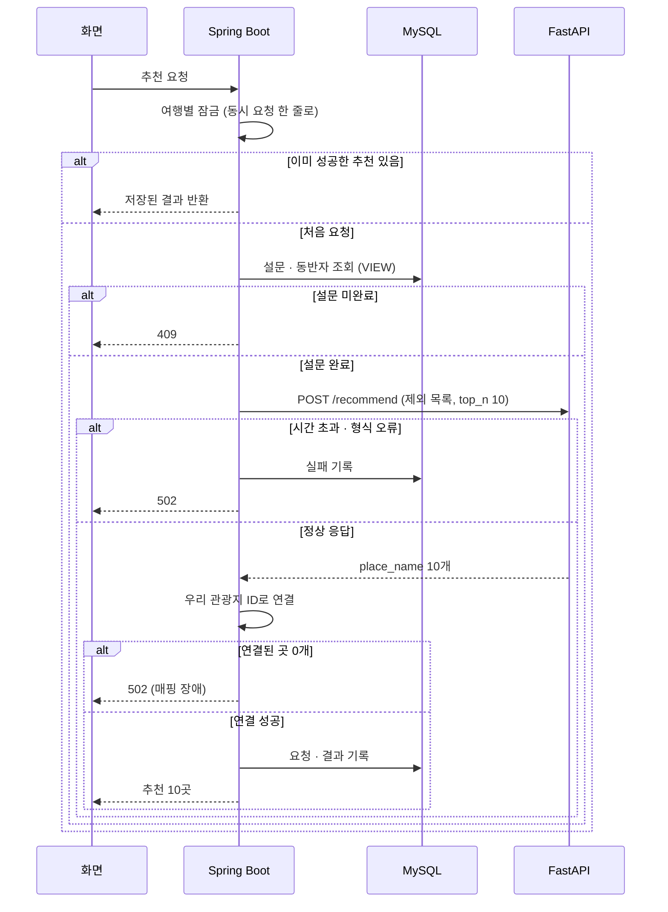

# JEJURO (개인 AI 맞춤 여행)

> 여행 조건과 취향을 바탕으로 AI가 제주 관광지 10곳을 추천하고, 날짜별 일정과 이동 경로까지 함께 계획하는 웹 서비스
>
> - **담당**: Backend · DevOps (2인 팀)
> - **기간**: 2026.09.21 ~ 2026.10.09 (약 3주)
> - **서비스**: [jejuro.projectbyhj.site](https://jejuro.projectbyhj.site)
> - **GitHub**: [LEEYEWIN/project1](https://github.com/LEEYEWIN/project1)

---

## 💡 내가 이 프로젝트로 알게 된 점

**1. 기능이 "동작한다"와 "깨지지 않는다"는 다르다**
일정 자동 저장은 혼자 쓸 때는 문제가 없었지만, 같은 일정을 두 탭에서 고치자 나중 저장이 앞의 수정을 말없이 지웠다. "전체 덮어쓰기" API는 서버가 요청이 어떤 상태를 보고 만들어졌는지 모른다는 걸 알게 됐고, 버전 비교(baseVersion)와 행 잠금으로 충돌을 **알리는** 방식을 배웠다. 격리 수준(READ COMMITTED vs REPEATABLE READ)이 잠금 결과에 영향을 준다는 것도 이때 직접 확인했다.

**2. 외부 API는 언젠가 실패한다는 전제로 설계해야 한다**
카카오모빌리티 길찾기, FastAPI 추천 서버 모두 실패하는 순간이 있었다. 실패를 그대로 화면에 넘기면 서비스 전체가 멈춘다. 타임아웃 · 응답 형식 검증 · 대체값(직선거리 추정) · 실패 기록을 두니 일부가 실패해도 핵심 흐름은 계속 동작했다. 대체값을 쓸 때는 **사용자에게 추정값임을 알려야** 한다는 점도 함께 배웠다.

**3. 보안과 안정성은 배포 이후가 아니라 API 설계와 테스트 단계에서 결정된다**
사용자 정보와 일정을 다루는 핵심 API마다 Spring Security 세션 및 CSRF 보호, 무차별 로그인 대입 차단(LoginAttemptLimiter), 관리자 CSV 수식 주입 방지(CsvNeutralize) 등 핵심 API 보안 테스트를 구축했습니다. 배포 완료 기준 또한 "서버가 실제로 정상 응답할 때"로 잡고 헬스체크와 응답 확인까지 자동화했습니다.

**4. 모델을 서비스에 붙이는 일도 하나의 개발 영역이다**
모델 자체는 팀장이 만들었지만, 설문 문항 → 피처 매핑, 제외 목록, 동시 요청 잠금, 결과 재사용, 추천 기록과 KPI까지 "모델을 안정적으로 쓰게 하는 일"이 생각보다 컸다. 역할을 나눠도 경계면(API 계약)을 명확히 하는 것이 협업의 핵심이었다.

---

## 👥 역할 분담

**김현지 · Backend · DevOps**

- **REST API**: 여행 · 경로 · 추천 · 커뮤니티 · 회원 · 관리자 컨트롤러 21개
- **소셜 로그인**: 카카오 · 네이버 · 구글 OAuth2 로그인과 계정 연동 · 해제 (연동된 회원만 로그인, 자동 가입 없음)
- **회원가입 · 로그인 문제 해결**: 팀장이 만든 기본 기능의 문제 해결과 보완
- **AI 서버 연동**: 입력 변환, 실패 대응, 추천 기록과 관리자 KPI
- **지도 · 경로**: 카카오모빌리티 길찾기, 방문 순서 계산, 택시 요금
- **배포 · 운영**: Docker Compose, AWS EC2, HTTPS, GitHub Actions 자동 배포

**이예원 · 팀장 · AI**

- CatBoost 추천 모델 학습 · 재학습
- FastAPI 추천 서버 (`/recommend`)
- 동반자 18-slot 피처 설계
- 회원가입 · 로그인 기본 기능 구현

---

## 🎬 시연

> ⭐ 표시는 아래 트러블슈팅과 연결되는 화면

### 1. 메인 화면

### 2. 여행 만들기

여행 이름 · 날짜 · 권역 · 동반자(최대 18명)를 단계별로 입력. 지난 날짜와 다른 여행과 겹치는 기간은 선택 불가

### 3. 취향 설문

여행 스타일 6문항 · 여행 동기 · 테마 설문 → AI 추천 입력으로 사용

### 4. AI 맞춤 추천 ⭐

제주 관광지 275곳 중 10곳 추천, '관심 없음'은 다음 추천부터 제외. Spring Boot → FastAPI 연동 · 실패 대응은 내 담당

### 5. 관광지 검색 · 담기

권역 · 분류 · 이름으로 검색, 상세 정보 · 지도 · 날씨 확인. 휴무일이 있는 장소는 담을 때 안내

### 6. 날짜별 일정 짜기 ⭐

담은 장소를 일차별로 배치 · 자동 저장, 경로선 · 이동 시간 · 택시 요금, 방문 순서 추천. → 트러블슈팅 ① 자동 저장 충돌 · ② 지도 · 경로

### 7. 일정 확정

모든 장소를 배치해야 확정 가능, 출발일부터는 확정한 일정을 바꿀 수 없도록 잠금

### 8. 여행 후기 작성

만족도 · 장소별 방문 여부 · 못 간 이유 기록 → 추천 모델 재학습에 활용

---

## 🏗 시스템 구성

- **한 주소로 통합**: Nginx가 `/api`, `/oauth2`, `/login/oauth2`만 Spring Boot로 넘기고 나머지는 React로 보냄 → 화면과 API가 같은 주소라 세션 쿠키(SameSite=Lax)와 CSRF가 로컬과 똑같이 동작
- **AI 서버 분리**: Spring Boot만 내부 네트워크로 FastAPI를 호출, AI · DB는 외부에 포트를 열지 않음
- **자동 배포**: main 푸시 → GitHub Actions → EC2에서 다시 빌드 → 응답 확인 후 완료

### AI 서버 연동 (내 담당 범위)

모델 자체(CatBoost 회귀, 입력 피처 76개, 후보 관광지 275곳, Recall@10 약 27.1%)는 팀장 담당. 나는 그 모델을 서비스에서 안정적으로 쓰도록 Spring Boot → FastAPI 연동을 맡음

| 구분 | 내용 |
|---|---|
| 입력 변환 | DB 설문 문항 → 모델 피처 이름 매핑, 권역 · 동반자 코드 전달, 관심 없음 · 숨김 장소는 제외 목록으로 전달 → 빼고도 10곳 유지 |
| 실패 대응 | 연결 5초 · 응답 30초 제한, 실패는 502로 통일, 형식이 다른 응답은 오류 처리, 같은 여행의 동시 요청은 잠금으로 한 줄로, AI 호출 중 트랜잭션 미사용 |
| 기록 · 재사용 | 요청마다 모델 버전 · 응답 시간 · 결과 수 저장, 성공한 추천은 다시 열어도 같은 결과, 기록이 관리자 KPI와 재학습 데이터로 이어짐 |

### 배포 자동화 (CI/CD)

main에 푸시하면 응답 확인까지 자동으로 진행. 배포 완료 기준을 "서버가 실제로 응답할 때"로 잡음

1. **main 푸시**: GitHub Actions 실행, 배포가 겹치면 앞 배포가 끝난 뒤 진행
2. **EC2 접속 (SSH)**: 호스트 · 키는 GitHub Secrets로 관리, 최신 코드 받기
3. **사전 검사**: 비밀 설정 파일이 없으면 배포 중단
4. **다시 빌드 · 실행**: docker compose로 web · api · ai · db 4개 컨테이너, db 헬스 체크 통과 후 api 시작
5. **응답 확인**: `/api/auth/csrf` 응답을 최대 3분 확인해야 완료

---

## 🛠 기술 스택

| 구분 | 기술 | 사용한 곳 |
|---|---|---|
| Backend | Java 21 · Spring Boot 4.1 · Spring Security · JPA · Validation · Mail · springdoc-openapi | REST API, 세션 + CSRF 인증, 이메일 인증 |
| 인증 | OAuth2 Client (카카오 · 네이버 · 구글) | 소셜 로그인 · 계정 연동 |
| Frontend | React 18 · React Router 6 · Axios | 여행 계획 · 커뮤니티 · 관리자 화면 |
| AI | Python 3.11 · FastAPI · CatBoost · pandas | 관광지 추천 서버 (팀장 담당) |
| Database | MySQL 8 | 30 TABLE + VIEW 3 |
| Infra | Docker Compose · Nginx · AWS EC2 · Let's Encrypt · GitHub Actions | 4개 컨테이너 운영, HTTPS, 자동 배포 |
| 외부 연동 | Kakao Map API · 카카오모빌리티 · Open-Meteo · Gmail SMTP | 지도 · 길찾기 · 날씨 · 메일 |

**기술 선택 이유와 검증**

| 기술 | 고른 이유 | 확인 방법 |
|---|---|---|
| Spring Security 세션 + CSRF | 화면과 API가 같은 주소 → 토큰을 브라우저에 저장하지 않는 쿠키 세션, 상태 변경 요청은 CSRF로 보호 | AuthControllerTest 8개 · LoginAttemptLimiterTest 5개 |
| 핵심 API 보안 테스트 | 무차별 대입 공격 차단, 관리자 CSV 수식 주입(CSV Injection) 방지, 비인가 요청 방어 | LoginAttemptLimiterTest 5개 · CsvNeutralizeTest 2개 · AuthControllerTest 8개 |
| JPA + 행 잠금 | 같은 여행에 저장 · 장소 빼기 · 확정 요청이 겹칠 수 있음 | 동시성 단위 테스트는 다음 단계 |
| FastAPI 분리 | 모델이 Python 생태계 · Spring과 장애 · 배포 단위를 나눔 | RecommendServiceTest 3개 |
| Docker Compose · GitHub Actions | 서버 4개를 한 EC2에서 같은 설정으로 다시 만들 수 있게 | 배포마다 응답 확인 자동화 |
| 관리자 KPI | 추천 담기율 · 확정률 · 만족도를 모델 버전별로 비교 | CsvNeutralizeTest 2개 (CSV 수식 주입 방지) |

---

## 🔥 트러블슈팅

### ① 자동 저장이 다른 탭의 수정을 덮어씀

> 🚨 **문제**: 일정 화면은 변경 후 0.7초 뒤 자동 저장함. 같은 일정을 두 탭에서 고치면 나중에 저장된 탭이 앞 탭의 수정을 말없이 지움

> 🔍 **원인**: 저장 API가 "일정 전체 덮어쓰기" 방식 → 서버는 요청이 어떤 상태를 보고 만들어진 것인지 알 수 없음

**해결**
1. **버전 만들기**: 경로 이름 + 일차별 방문 순서를 SHA-256으로 해시해 응답에 `version`으로 내려주고, 저장 요청에 `baseVersion`으로 다시 받음 (DB 칸 추가 없음)
2. **서버에서 비교**: 여행 행을 잠근 뒤(`SELECT … FOR UPDATE`) 현재 버전과 비교, 다르면 409. 격리 수준은 READ COMMITTED (REPEATABLE READ에서는 잠금 전 스냅샷을 읽어 비교가 틀어질 수 있음)
3. **화면에서 처리**: 409를 받으면 자동 저장을 멈추고 알림. 저장 못 한 변경은 sessionStorage에 보관하고, 다시 열었을 때 버전이 같을 때만 복구

> ✅ **결과**: 말없는 덮어쓰기 → "다른 화면(탭)에서 이 경로가 먼저 바뀌었어요" 알림 + 최신 경로 다시 불러오기

### ② 길찾기 API가 실패해도 일정 화면은 멈추지 않게

> 🚨 **문제**: 카카오모빌리티는 섬 · 산처럼 도로 탐색이 안 되는 곳에서 실패함 → 경로선 · 이동 시간 · 택시 요금이 비어 화면이 멈춤. 방문 순서도 사용자가 직접 맞춰야 했음

**해결 A: 실패 시 추정값으로 대체**
- 카카오 호출 실패를 잡아 직선거리 × 추정 속도(40km/h)로 거리 · 시간 · 택시 요금 계산
- 오류 메시지를 사용자가 이해할 수 있는 문장으로 바꾸고 "직선거리 추정값으로 표시"라고 명시
- 섬(배편) · 산(주차 · 등산) 장소는 따로 안내

**해결 B: 방문 순서 추천 (외부 API 없이 서버에서 계산)**

| 순서를 바꿀 장소 수 | 방법 | 결과 |
|---|---|---|
| 8곳 이하 | 모든 순서 비교 (8! = 40,320가지, 즉시 계산) | 정확한 최단 (EXACT) |
| 9곳 이상 | 최근접 이웃으로 잇고 → 2-opt로 꼬인 구간을 뒤집어 짧아지면 교체 | 근사 (HEURISTIC) |

> ✅ **결과**: 외부 API가 실패해도 일정 편집은 계속 동작하고, 계산 결과가 정확값인지 근사값인지 함께 알려 줌

### ③ 배포하며 겪은 문제

| 문제 | 원인 | 해결 |
|---|---|---|
| 설정 파일이 폴더로 바뀜 | 없는 파일을 컨테이너에 연결하면 Docker가 같은 이름의 빈 폴더를 만들어 이후 업로드가 꼬임 | 배포 첫 단계에서 파일 존재를 확인하고 없으면 중단 |
| 재배포 직후 502 | api 컨테이너가 새로 만들어지면 Nginx가 예전 컨테이너 주소를 기억함 | api를 다시 만든 뒤 web(Nginx)도 다시 시작 |
