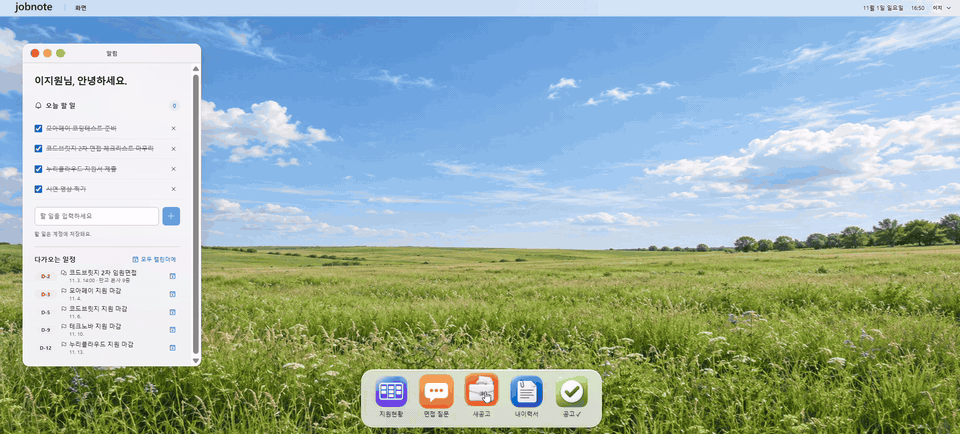
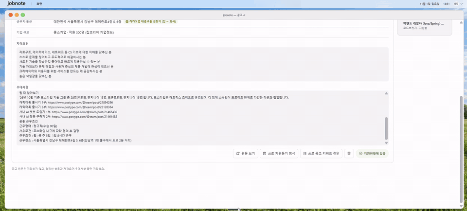
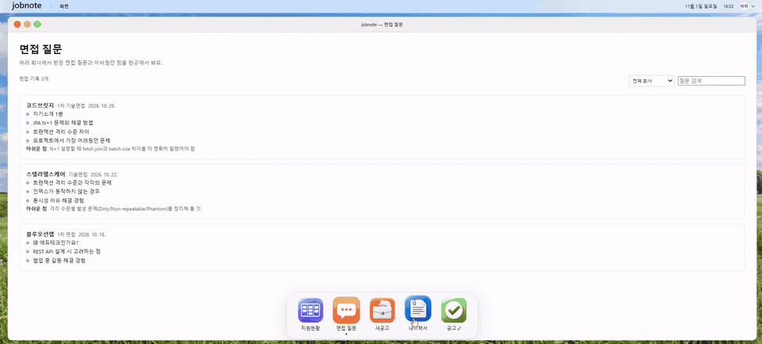
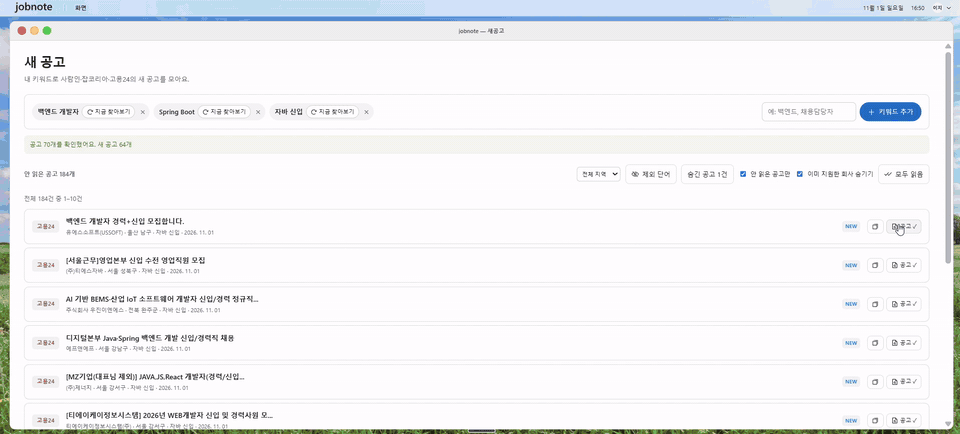
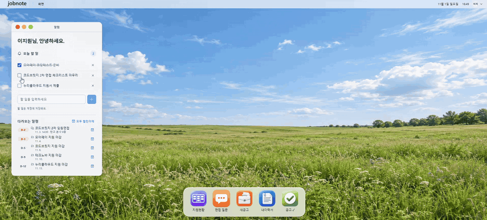
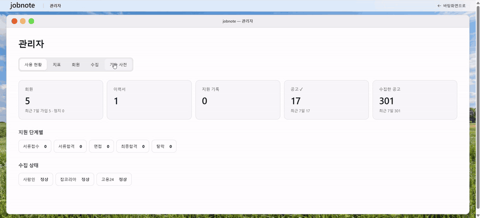
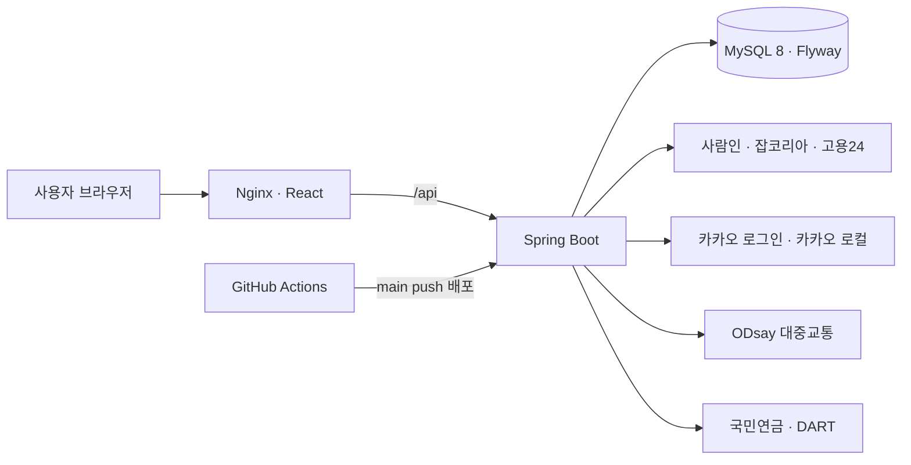
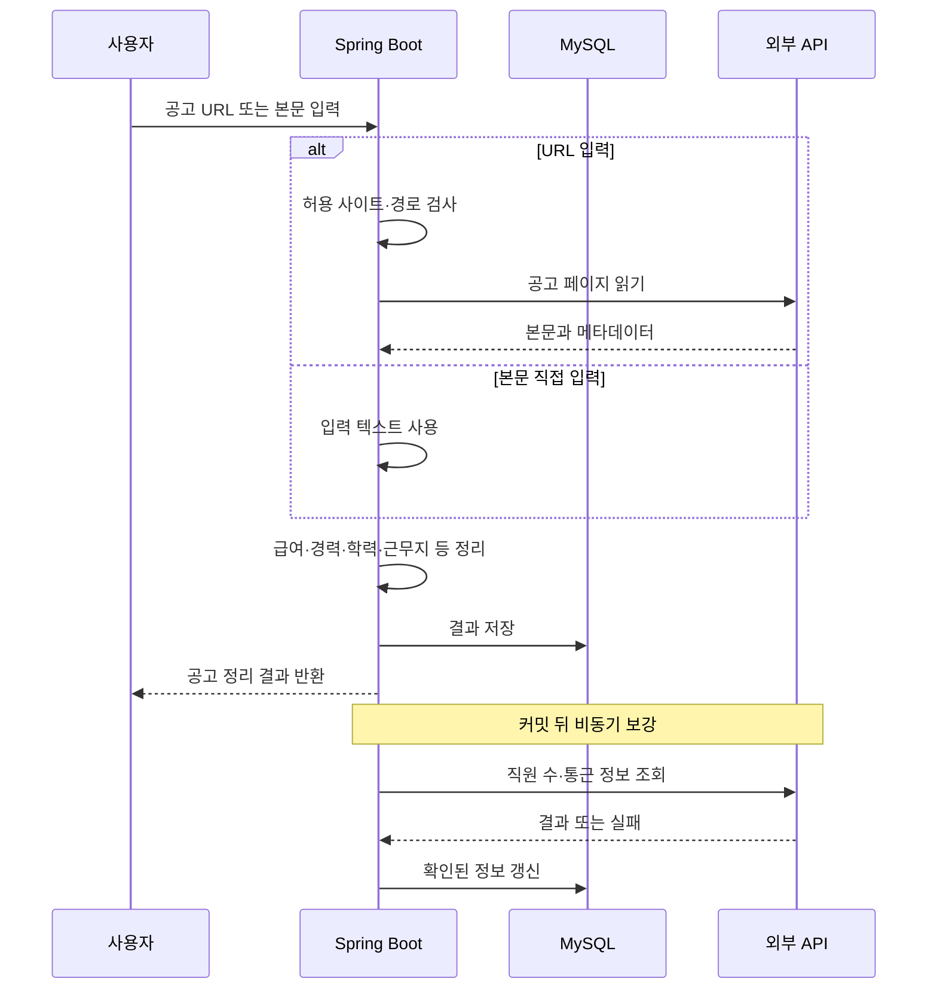

# JOBNOTE (취업 준비 관리)

> 채용 공고 탐색부터 지원 현황, 이력서, 면접 기록까지 취업 준비 과정을 한곳에서 관리하는 웹 서비스
>
> - **담당**: 기획 · 디자인 · Frontend · Backend · 테스트 · 배포 (개인 프로젝트)
> - **기간**: 2026.10.21 ~ 2026.10.29 (약 1주) · 1인
> - **GitHub**: [hamzzy-oao/project3](https://github.com/hamzzy-oao/project3)

---

## 💡 내가 이 프로젝트로 알게 된 점

**1. 외부 사이트에 의존하는 기능은 "조용한 실패"를 감지해야 한다**
채용 사이트 HTML이 바뀌면 파서는 예외 없이 빈 목록을 돌려준다. 이건 "공고가 없음"과 구분되지 않는다. 한 사이트에서 서로 다른 키워드 3개 이상이 모두 0건이면 구조 변경 가능성을 기록하도록 해서, **에러가 나지 않는 실패도 신호로 만드는 법**을 배웠다.

**2. 응답에 꼭 필요한 것과 나중에 채워도 되는 것을 나눈다**
공고 정리 결과에 직원 수 · 통근 시간까지 기다리면 외부 API 속도에 화면이 묶인다. 공고 내용은 먼저 저장 · 응답하고, 커밋 후 비동기로 보강하는 구조를 적용했다. 또 "기업을 못 찾음"과 "외부 호출 실패"를 구분해야 실패한 조회를 다시 시도할 수 있다는 점도 알게 됐다.

**3. 무중단 배포는 서버뿐 아니라 화면 파일과 DB까지 함께 봐야 한다**
새 백엔드를 옆에 띄우고 상태를 확인한 뒤 교체해도, 오래된 화면이 지연 로딩하는 파일이 사라지거나 DB 마이그레이션이 구버전과 충돌하면 문제가 생긴다. 직전 assets 유지와 마이그레이션 호환성 검사를 두면서 배포를 전체 흐름으로 보게 됐다.

**4. 한계를 알고 기록해 두는 것도 설계의 일부다**
수집 잠금과 조회 진행 상태가 서버 메모리에 있어 재시작 · 다중 서버에서는 보장되지 않고, 현재 워크플로는 테스트와 배포가 병렬이다. 지금 구조가 어디까지 보장하는지 정리해 두니 다음에 무엇을 고쳐야 할지가 분명해졌다.

**5. 품질 게이트는 분기 커버리지까지 봐야 실질적인 안전망이 된다**
단순 라인 커버리지에 만족하지 않고, Service(서비스) 계층 테스트 분기 커버리지를 73%에서 80.3%로 끌어올렸습니다. 특히 PDF 내보내기와 공고 링크 읽기 등 엣지 케이스의 예외 처리를 테스트로 집중 보강했으며, GitHub Actions CI 파이프라인에 서비스 계층 분기 커버리지 80% 미만이면 CI가 실패해 PR이 합쳐지지 않게 막는 품질 게이트(Quality Gate)를 설정하여 결함을 사전에 원천 차단했습니다.

---

## 🧪 테스트 · 품질

- **Service(서비스) 계층 분기 커버리지 80.3% (JaCoCo)**
- **80% 미만이면 CI가 실패해 PR이 합쳐지지 않음** (GitHub Actions CI 품질 게이트)
- **73% → 80%**: PDF 내보내기 · 공고 링크 읽기의 예외 경우를 테스트로 채움

---

## 🎬 시연

### 1. 새로운 채용 공고 (사람인 · 잡코리아 · 고용24 수집)

### 2. 지원 현황과 면접 기록

### 3. 이력서 (작성 · PDF 가져오기 · 내보내기)

### 4. 공고 정리와 통근 정보

### 5. 할 일

### 6. 관리자

---

## 🏗 시스템 구성

- **한 주소로 연결**: Nginx가 React 화면과 백엔드 API를 같은 주소로 제공
- **컨테이너**: Docker Compose로 MySQL · 백엔드 · Nginx 실행
- **DB 변경 기록**: Flyway 마이그레이션 + JPA 스키마 검증
- **CI/CD**: PR에서는 마이그레이션 검사 · 백엔드/프론트 테스트 · 빌드, main push에서는 검사와 배포가 함께 실행 (배포는 검사 완료를 기다리지 않음)

### 공고 정리 처리 흐름

### ERD

| 데이터 | 역할 |
|---|---|
| 사용자 · 검색 조건 · 수집 공고 | 계정별 검색 조건과 수집 결과 연결 |
| 지원 현황 · 면접 · 회사 메모 | 지원 과정과 면접 준비 기록 |
| 이력서 | 작성 · 가져오기 · 내보내기에 사용하는 이력서 데이터 |
| 공고 정리 · 기업 정보 | 공고에서 정리한 항목과 외부 조회 결과 저장 |

---

## 🛠 기술 스택

| 구분 | 기술 | 사용한 곳 |
|---|---|---|
| Backend | Java 21 · Spring Boot 4.1 · Spring Security · JPA · Validation · Caffeine | REST API, 인증, 캐시 |
| 인증 | JWT (jjwt 0.13, access · refresh) · 카카오 로그인 | 로그인 · 토큰 재발급 |
| Frontend | React 19 · Vite · React Router 6 · Axios · Phosphor Icons | 공고 · 지원 현황 · 이력서 화면 |
| Database | MySQL 8 · Flyway | 서비스 데이터, DB 변경 이력 관리 |
| 문서 · 수집 | Jsoup · PDFBox 3 | 채용 공고 파싱, 이력서 PDF 가져오기 · 내보내기 |
| 테스트 · CI 게이트 | JUnit · Testcontainers (MySQL) · JaCoCo (Service 계층 분기 커버리지 80.3% CI 게이트) · Vitest | 파서 · 공고 정리 · 인증 · 이력서 테스트, 80% 미만 시 PR merge 차단 |
| Infra | Docker Compose · Nginx · GitHub Actions | 컨테이너 실행, 무중단 교체 배포 |
| 외부 연동 | 카카오 로컬 · ODsay · 국민연금 · DART | 주소 좌표, 대중교통 통근 시간, 기업 직원 수 |

---

## 🔥 트러블슈팅

### ① 채용 사이트 구조가 바뀌면 수집 0건이 성공처럼 보임

> 🚨 **문제**: 채용 사이트 HTML 구조가 바뀌면 파서가 공고를 찾지 못한다. 예외 없이 빈 목록을 반환하면 실제로 공고가 없는 상황과 구분하기 어렵다.

> 🔍 **원인**: 사이트별 HTML 구조를 기준으로 제목 · 회사 · 링크를 추출하므로 외부 사이트의 화면 변경에 영향을 받는다.

**해결**
1. 사이트별 파서를 분리해 검색 결과 첫 페이지에서 공고 정보를 읽음
2. 한 사이트에서 **서로 다른 키워드 3개 이상이 모두 0건**이고 다른 실패가 없다면 구조 변경 가능성을 수집 실패 기록에 남김
3. 같은 검색어는 사용자 간 수집 결과를 공유하고, 연속 요청 사이에 간격을 둠. 한 서버에서는 수집 중 중복 요청도 제한
4. 파서 검증용 페이지와 테스트 코드(`SearchParserTest`)를 보관

> ✅ **결과**: 조용히 비어 보이던 상황을 관리자가 확인할 수 있게 됨. 0건 감지는 확정 판정이 아니라 "확인 필요" 신호

### ② 직원 수 · 통근 시간 조회가 공고 정리 응답을 늦춤

> 🚨 **문제**: 공고를 읽은 뒤 외부 API로 기업 · 통근 정보를 모두 받아야 결과를 보여주면, 외부 응답 속도에 화면이 묶인다.

> 🔍 **원인**: 직원 수는 국민연금 · DART, 통근 시간은 주소 좌표와 대중교통 경로처럼 별도의 외부 조회가 필요하다.

**해결**
1. 연봉 · 경력 · 학력 · 근무지 등 먼저 정리할 수 있는 내용을 저장해 바로 반환
2. DB 커밋 후 직원 수와 통근 시간을 별도 작업으로 조회해 결과 보강
3. 기업 조회에서 **찾지 못한 경우와 외부 호출 실패를 구분** → 실패는 영구 미발견으로 저장하지 않아 다시 조회 가능
4. 공고 URL은 지원하는 사이트의 지정된 주소만 허용해 임의 주소 요청 차단

> ✅ **결과**: 외부 정보가 늦어도 공고의 기본 내용은 먼저 확인 가능

### ③ 새 버전 배포 중 기존 요청과 DB 변경이 겹침

> 🚨 **문제**: 서버를 교체하는 동안 기존 요청이 끊기거나, 구버전과 신버전이 같은 DB를 잠시 함께 사용할 수 있다.

**해결**
1. 새 백엔드를 기존 백엔드 옆에 띄우고 health 응답을 확인한 뒤 기존 컨테이너 종료
2. 이전 요청이 끝날 유예 시간을 두고, 프론트 빌드는 새 백엔드 확인 후 공개
3. 오래된 화면이 지연 로딩하는 파일도 찾을 수 있도록 직전 assets 유지
4. 호환성을 깨뜨릴 수 있는 DB 마이그레이션을 검사하는 CI 단계(`check-migrations.sh`) 추가

> ✅ **결과와 한계**: 일반적인 백엔드 교체 시 중단을 줄임. 다만 MySQL 설정 변경으로 DB 컨테이너를 다시 만들 때는 중단이 생길 수 있고, 테스트와 배포가 병렬이라 테스트 성공 후 배포가 보장되지는 않음 → 다음 단계

### ④ 테스트 분기 커버리지 80.3% 상향 및 CI 품질 게이트 구축

> 🚨 **문제**: 채용 공고 수집 파싱과 다중 지원 상태 변경 등 복잡한 비즈니스 로직에서 예외 분기가 누락되면 실제 운영 환경에서 예기치 못한 NPE나 데이터 정합성 오류 발생

> 🔍 **원인**: 단순 라인 커버리지만으로는 if/else 조건문과 예외 처리의 모든 경로(Branch)를 온전히 검증하기 어려움

**해결**
1. JaCoCo를 통해 **Service(서비스) 계층 분기 커버리지 80.3% 달성** (기존 73% → 80.3%)
2. **73% → 80% 달성 과정**: PDF 내보내기 · 공고 링크 읽기의 예외 경우를 테스트로 채움
3. GitHub Actions CI에 **서비스 계층 분기 커버리지 80% 미만이면 CI가 실패해 PR이 합쳐지지 않게 막는 품질 게이트** 적용

> ✅ **결과**: 예외 분기 누락으로 인한 잠재 결함 사전 차단 및 코드 품질 기준선 확립
