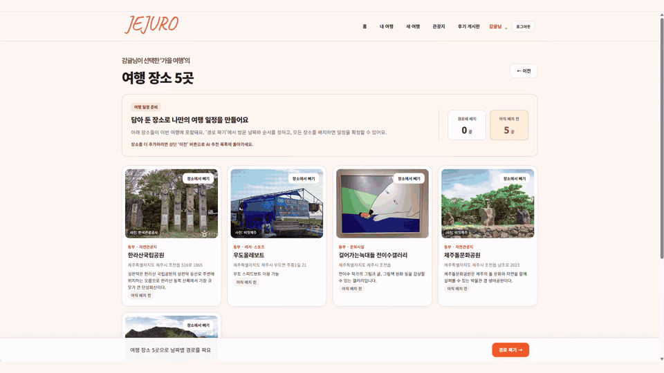
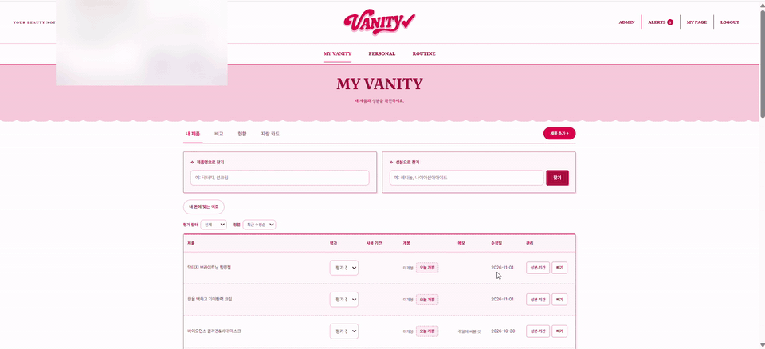
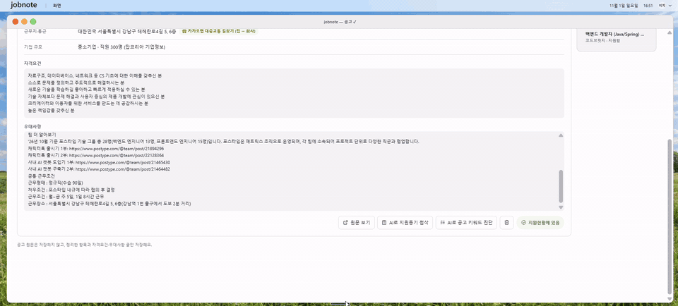

# Backend Developer Portfolio

Java · Spring Boot 기반으로 서비스를 기획부터 배포까지 직접 만들어 온 프로젝트를 정리했습니다.

---

## 🛠 기술 스택

| 구분 | 기술 |
|---|---|
| Backend | Java · Spring Boot · Spring Security · JPA · JWT · OAuth2 |
| Database | MySQL |
| Frontend | React · JavaScript |
| AI | Python · FastAPI · CatBoost |
| DevOps | Docker · AWS EC2 · Nginx · GitHub Actions |
| Test · Tool | JUnit · Git |

---

## 📂 프로젝트

| 프로젝트 | 설명 | 기간 · 인원 | 링크 |
|---|---|---|---|
| **JEJURO** 개인 AI 맞춤 여행 | 여행 조건과 취향을 바탕으로 AI가 제주 관광지를 추천하고, 날짜별 일정과 이동 경로까지 계획 | 2026.09.21 ~ 10.09 (약 3주) 팀 2명 | [상세](./JEJURO) · [코드](https://github.com/LEEYEWIN/project1) · [서비스](https://jejuro.projectbyhj.site) |
| **VANITY** 나만의 화장대 | 보유 화장품과 피부 기록을 바탕으로 성분을 확인하고, 나에게 맞는 사용 루틴을 관리 | 2026.10.13 ~ 10.20 (약 1주) 개인 1명 | [상세](./VANITY) · [코드](https://github.com/hamzzy-oao/mycosmetic) |
| **JOBNOTE** 취업 준비 관리 | 채용 공고 탐색부터 지원 현황, 이력서, 면접 기록까지 취업 준비 과정을 한곳에서 관리 | 2026.10.21 ~ 10.29 (약 1주) 개인 1명 | [상세](./JOBNOTE) · [코드](https://github.com/hamzzy-oao/project3) |

---

### JEJURO · 개인 AI 맞춤 여행
`Java` `Spring Boot` `React` `Python` `FastAPI` `CatBoost` `MySQL` `Docker` `AWS EC2` `Spring Security` `OAuth2` `JPA` `Kakao Map API`

### VANITY · 나만의 화장대
`Java` `Spring Boot` `React` `MySQL` `Spring Security` `JWT` `OAuth2` `JPA` `Docker` `AWS EC2` `GitHub Actions`

### JOBNOTE · 취업 준비 관리
`Java` `Spring Boot` `React` `MySQL` `Spring Security` `JWT` `JPA` `Docker` `Nginx` `AWS EC2` `GitHub Actions`

