# VANITY (나만의 화장대)

> 보유 화장품과 피부 기록을 바탕으로 성분을 확인하고, 나에게 맞는 사용 루틴을 관리하는 웹 서비스
>
> - **담당**: 기획 · 디자인 · Frontend · Backend · 테스트 · 배포 준비 (개인 프로젝트)
> - **기간**: 2026.10.13 ~ 2026.10.20 (약 1주) · 1인
> - **GitHub**: [hamzzy-oao/mycosmetic](https://github.com/hamzzy-oao/mycosmetic)

---

## 💡 내가 이 프로젝트로 알게 된 점

**1. 잠금은 "거는 순서"까지 정해야 한다**
두 사용자가 같은 성분표를 동시에 저장하자 DB가 한쪽을 강제로 취소했다. 확인 기록을 넣을 때 DB가 자동으로 건 읽기 잠금 때문에 서로를 기다리는 교착 상태였다. 모든 저장 경로가 **같은 순서로 먼저 잠그도록** 바꾸면서, 잠금을 거는 것만큼 순서를 맞추는 것이 중요하다는 걸 배웠다.

**2. 동시 요청은 "확인 후 저장" 사이의 틈에서 깨진다**
요청마다 오늘 저장한 횟수를 세고 저장하면, 동시에 들어온 요청이 같은 숫자를 보고 하루 한도(20회)를 넘을 수 있다. 사용자 행을 잠근 상태에서 확인과 저장을 한 번에 처리하는 방식으로, JEJURO에서 배운 행 잠금을 다른 문제에 다시 적용해 볼 수 있었다.

**3. 자동화의 결과를 사용자가 확인할 수 있게 해야 한다**
성분명은 표기 차이와 이명이 많고, 캡처를 글자로 읽은(OCR) 결과도 틀릴 수 있다. 무조건 자동으로 확정하기보다 EXACT → ALIAS → FUZZY → UNMATCHED로 단계를 나누고, 애매한 결과는 사용자가 고르게 했다. 정확도를 100%로 만들 수 없을 때는 **불확실성을 드러내는 것**이 더 나은 설계라는 걸 알게 됐다.

**4. 혼자 만드는 프로젝트일수록 기준을 먼저 정해야 한다**
기획 · 디자인 · 프론트 · 백엔드 · 배포를 모두 맡다 보니 결정할 것이 많았다. Flyway로 DB 변경 이력을 남기고, 서비스 계층 커버리지 80% 기준과 CI를 먼저 세워 두니 기능을 늘려도 이전 기능이 깨졌는지 바로 확인할 수 있었다.

---

## 🎬 시연

### 1. 회원가입 · 로그인 (카카오 연동)
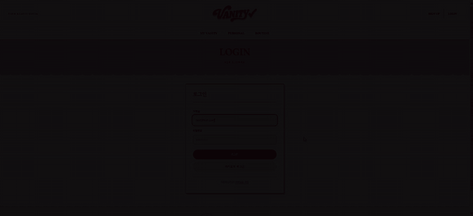

### 2. 제품 등록 (링크 · 전성분 붙여넣기 · 캡처 글자 읽기)
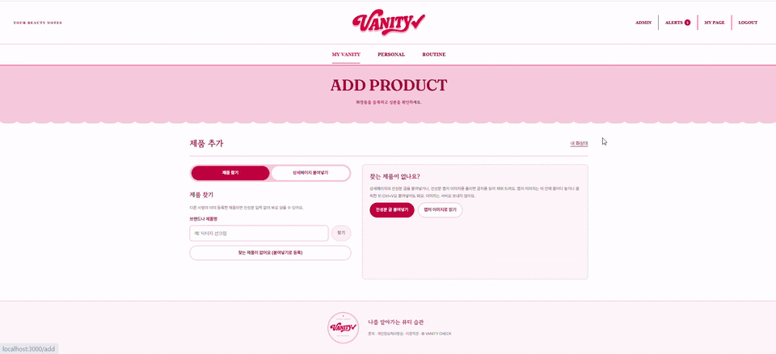

### 3. 나의 화장대
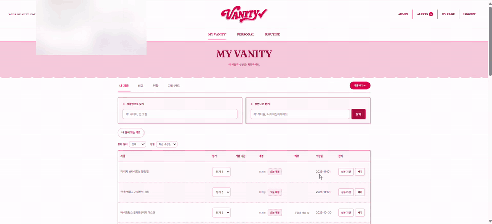

### 4. 피부 분석 · 피부 일지
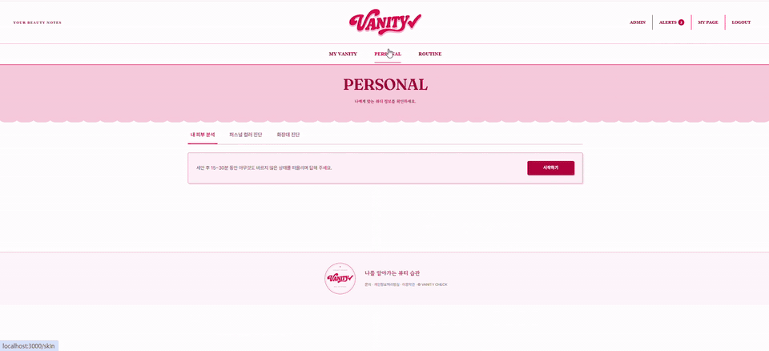

### 5. 사용 루틴 · 새 제품 테스트
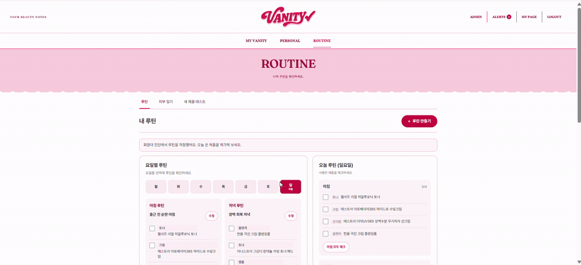

### 6. 퍼스널컬러
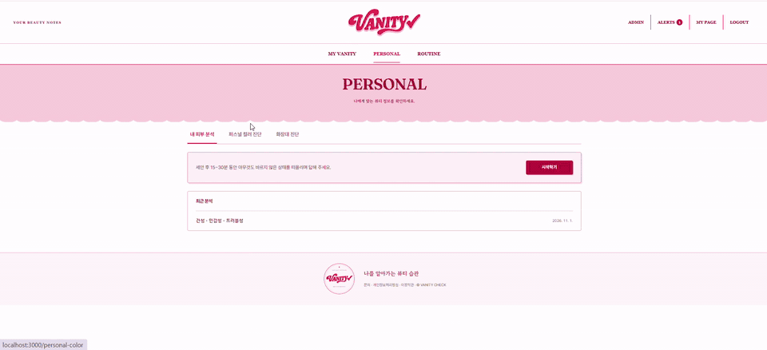

### 7. 화장대 분석 · 비교
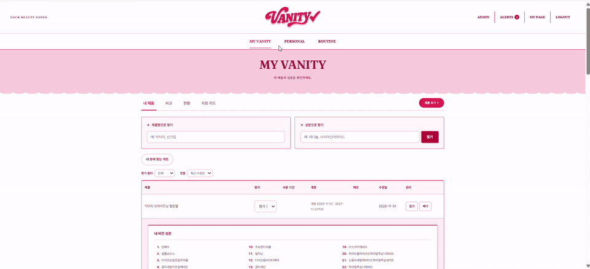

### 8. 관리자
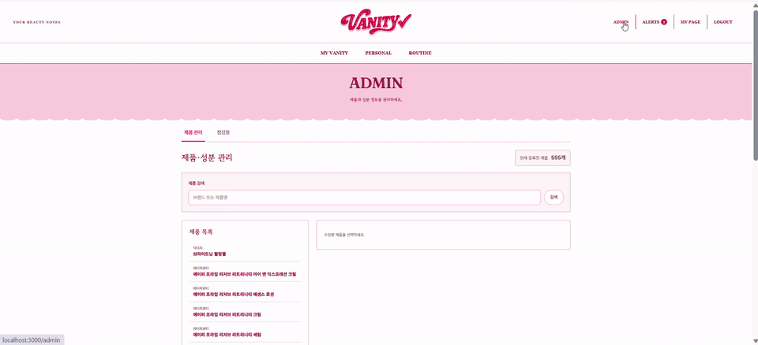

---

## 🏗 시스템 구성

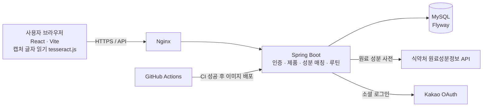

- **한 애플리케이션**: Gradle이 프론트엔드 빌드 결과와 Flyway SQL을 JAR에 포함
- **캡처 처리**: 전성분 캡처는 브라우저 안에서 글자로 읽고(tesseract.js) 이미지는 서버로 보내지 않음. 서버는 받은 글을 성분 사전과 대조
- **배포**: main 배포 워크플로가 CI를 호출하고, 성공 후 이미지를 빌드해 GHCR에 올림. 배포 스크립트는 헬스체크 실패 시 이전 이미지로 롤백
- **DB 운영**: RDS 대신 EC2 안 MySQL 컨테이너(Docker 네트워크) + 매일 백업

### 전성분 등록: 정상 흐름과 예외 분기

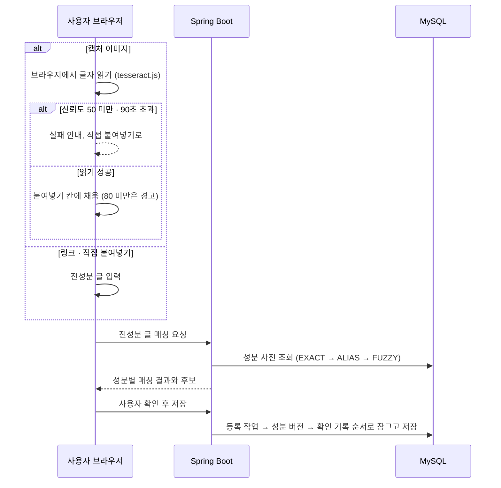

### 데이터 설계 (주요 관계)

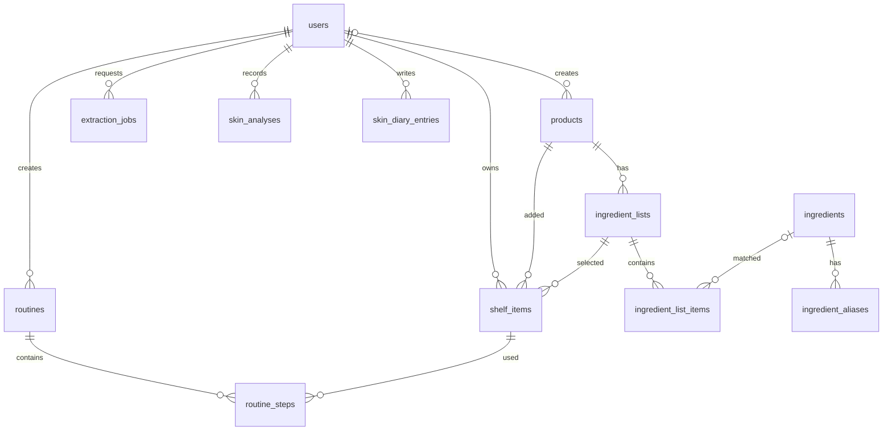

---

## 🛠 기술 스택

| 구분 | 기술 | 사용한 곳 |
|---|---|---|
| Backend | Java 21 · Spring Boot 4.1 · Spring Security · JPA · Validation · Actuator | REST API, 인증, 성분 매칭 · 저장 |
| 인증 | JWT (OAuth2 Resource Server) · OAuth2 Client (카카오) | 로그인 · 카카오 계정 연동 |
| Frontend | React 18 · Vite · React Router 6 · Axios | 화장대 · 루틴 · 피부 기록 화면 |
| 브라우저 처리 | MediaPipe Tasks Vision · Tesseract.js | 퍼스널컬러 얼굴 색상 입력, 브라우저 OCR |
| Database | MySQL 8 · Flyway | 서비스 데이터, DB 변경 이력 관리 |
| 데이터 | 식약처 원료성분정보 API · Apache Commons Text | 성분 사전, 유사도 매칭 |
| 테스트 | JUnit · JaCoCo (서비스 계층 80%) · Vitest · Testing Library | 백엔드 · 프론트 테스트 |
| Infra | Docker · Nginx · AWS EC2 · GitHub Actions · GHCR | 컨테이너 배포, 롤백, DB 백업 |

---

## 🔥 트러블슈팅

### ① 같은 성분표를 동시에 저장하면 한쪽이 취소됨

> 🚨 **문제**: 사용자 A와 B가 같은 제품의 같은 성분표를 거의 동시에 저장하면, DB가 한쪽 저장을 강제로 취소해 오류 화면이 떴다.

> 🔍 **원인**: 저장 순서가 "확인 기록 추가 → 성분 버전 수정"이었다. 확인 기록을 넣는 순간 DB가 연결된 성분 버전에 자동으로 읽기 잠금을 걸고, 두 사람이 서로의 잠금이 풀리길 기다리며 멈췄다(교착 상태).

**해결**
1. 저장할 때 성분 버전을 **먼저 비관적 잠금**(`@Lock` · `FOR UPDATE`)으로 잡음
2. 모든 저장 경로의 잠금 순서를 **등록 작업 → 성분 버전 → 확인 기록**으로 고정
3. "이미 있음" 충돌이 나면 새 트랜잭션으로 처음부터 한 번 더 시도
4. (성분 버전, 사용자) UNIQUE 제약으로 같은 사람의 같은 확인은 DB가 한 번만 허용

> ✅ **결과**: 두 사람 동시 저장 → 둘 다 성공(버전 1개 · 확인 2개 → VERIFIED), 4명 동시 저장 → 서버 오류(500) 0건. 동시 저장을 실제 스레드로 재현하는 `ProductConfirmConcurrencyTest`로 검증

### ② 같은 성분도 표기가 다르고 OCR 결과가 모호함

> 🚨 **문제**: 이미지에서 읽은 성분명이 사전의 표준명과 다르거나, 하나의 이명이 여러 성분에 대응할 수 있다.

> 🔍 **원인**: 원문 표기와 식약처 사전의 표준명 · 이명이 항상 같지 않고, 글씨가 흐리면 글자 읽기 결과도 달라진다.

**해결**

| 단계 | 조건 | 처리 |
|---|---|---|
| EXACT | 정규화한 표준명과 일치 | 해당 성분에 연결 |
| ALIAS | 이명이 하나의 성분에만 연결 | 해당 성분에 연결 |
| FUZZY | 전문 검색 후보 20개 중 유사도 0.8 이상 | 최대 3개 후보 제시 → 사용자 선택 |
| UNMATCHED | 적합한 후보 없음 | 미일치로 구분 표시 |

> ✅ **결과**: 모호한 결과를 자동 확정하지 않고, 원문과 매칭 상태를 함께 보여 사용자가 확인할 수 있음

### ③ 캡처 글자 읽기(OCR) 결과를 믿어도 되는지 알 수 없음

> 🚨 **문제**: 상세페이지 캡처를 브라우저에서 글자로 읽으면, 작은 캡처 · 흐린 글자 · 글자 없는 그림에서 엉뚱한 결과가 그대로 성분 칸에 들어갈 수 있다.

> 🔍 **원인**: 캡처 크기와 화질에 따라 정확도 차이가 크고, 성분 목록의 쉼표를 마침표로 잘못 읽는 일이 많다.

**해결**
1. 이미지 종류별 신뢰도를 직접 측정: 보통 글자 90 · 흐린 글자 82 · 가로 288px 캡처 74 · 글자 없는 그림 27
2. 신뢰도 **50 미만은 실패**(칸에 넣지 않음), **80 미만은 경고**와 함께 넣고, 80 이상은 그대로 넣음
3. 가로 2,400px가 되도록 키워서 읽고(최대 4배), 가로 600px 미만 캡처는 먼저 안내
4. 쉼표를 마침표로 잘못 읽은 곳과 한글 사이 공백을 보정하고, 90초 안에 끝나지 않으면 멈춘 뒤 직접 붙여넣기로 안내
5. 이미지는 서버로 보내지 않고 브라우저 안에서만 처리

> ✅ **결과**: 보통 상세페이지 글자는 성분 19개 중 17개를 그대로 읽음. 애매한 결과는 경고와 함께 사용자가 고친 뒤 저장 (측정 표본이 작아 정답 세트를 늘려 재측정 필요)
